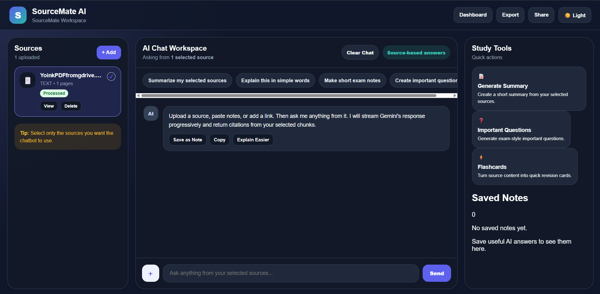

# SourceMate AI

A NotebookLM-style chatbot project with a Vite React frontend and an Express backend that streams Gemini responses over Server-Sent Events.

The app lets you create notebook workspaces, add sources, select sources for chat context, and stream Gemini answers into the chat UI. Text sources are included in the prompt. PDFs and images are stored in the browser and sent to Gemini as file attachments when selected.

## Demo 



## Project Structure

```txt
.
├── server/
│   ├── index.js
│   ├── package.json
│   └── .env.example
├── notebook-chatbot-frontend/
│   ├── src/
│   ├── public/
│   ├── package.json
│   └── .env.example
├── package.json
├── Procfile
└── README.md
```

## Requirements

- Node.js 18 or newer
- A Gemini API key

## Environment Setup

Create `server/.env`:

```txt
GEMINI_API_KEY=your_gemini_api_key_here
GEMINI_MODEL=gemini-3.1-flash-lite
JSON_BODY_LIMIT=25mb
```

Create `notebook-chatbot-frontend/.env`:

```txt
VITE_GEMINI_API_URL=http://localhost:3001
```

## Install

Install backend dependencies:

```bash
cd server
npm install
```

Install frontend dependencies:

```bash
cd ../notebook-chatbot-frontend
npm install
```

## Run Locally

From the project root, start the backend:

```bash
npm run server
```

In another terminal, start the Vite frontend:

```bash
npm run frontend
```

Open the Vite URL shown in the terminal, usually:

```txt
http://localhost:5173
```

## Build

Build the notebook frontend:

```bash
npm run build
```

After the build, the Express server can serve the Vite app from `notebook-chatbot-frontend/dist`:

```bash
npm run server
```

Then open:

```txt
http://localhost:3001
```

## Docker

Build and run the production container:

```bash
docker build -t chatstream:local .
docker run --env-file server/.env -p 3001:3001 chatstream:local
```

Or use the convenience scripts:

```bash
npm run docker:build
npm run docker:run
```

Open:

```txt
http://localhost:3001
```

Health check endpoint:

```txt
http://localhost:3001/health
```

For AWS ECR, App Runner, and ECS Fargate deployment steps, see:

```txt
docs/AWS_DEPLOYMENT.md
```

## Notes

- Uploaded sources are stored in the browser.
- PDFs and images are stored in IndexedDB and sent to Gemini as inline file data when selected.
- Inline PDF/image uploads are limited to 15 MB per file by the frontend.
- Text sources are stored in localStorage and included in the Gemini prompt.
- The old Create React App frontend has been removed.

## Push To GitHub

Initialize Git if needed:

```bash
git init
git branch -M main
```

Stage and commit:

```bash
git add .
git commit -m "Set up Gemini notebook chatbot"
```

Create a new empty repository on GitHub, then connect it:

```bash
git remote add origin https://github.com/YOUR_USERNAME/YOUR_REPO.git
git push -u origin main
```

If the remote already exists:

```bash
git remote set-url origin https://github.com/YOUR_USERNAME/YOUR_REPO.git
git push -u origin main
```
